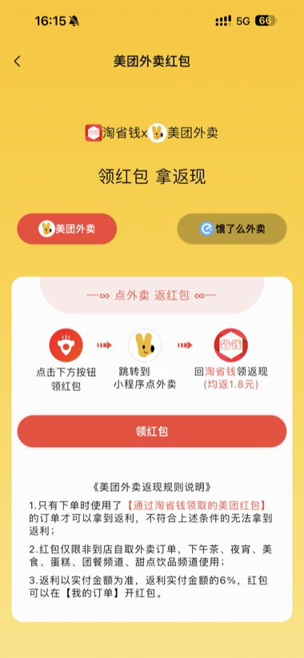

# 苏分宝淘客系统 · 服务端

苏分宝是一套包含 **Flutter APP、运营管理后台和 Java 服务端** 的淘客系统，围绕商品查券、推广转链、订单采集、佣金结算、分销与提现开展业务。

本仓库为开源版 Java 服务端 `sfb_server`，包含管理端 API、APP API、核心业务模块与订单采集任务。当前使用 **Java 8 + Spring Boot 2.6.7**，与商业版服务端的环境要求分别说明。

开源版功能按当前 `sfb_admin`、`sfb_server`、`sfb` 三个项目整理；商业版能力与交付范围参照官方文档。

[官方文档](https://www.mailvor.com) · [功能对比](https://www.mailvor.com/01.介绍/30.functional.html) · [演示体验](https://www.mailvor.com/01.介绍/20.demo.html) · [版本与授权](https://www.mailvor.com/01.介绍/40.price.html)

## 项目组成

| 项目 | 用途 | 源码 |
| --- | --- | --- |
| `sfb_admin` | 运营管理后台：用户、订单、财务、营销、配置及系统管理 | [GitHub](https://github.com/jacky4631/sfb_admin) · [Gitee](https://gitee.com/jacky4631/sfb_admin) |
| `sfb_server`（本仓库） | 管理端 API、APP API、第三方平台对接与定时任务 | [GitHub](https://github.com/jacky4631/sfb_server) · [Gitee](https://gitee.com/jacky4631/sfb_server) |
| `sfb` | Android / iOS Flutter APP | [GitHub](https://github.com/jacky4631/sfb) · [Gitee](https://gitee.com/jacky4631/sfb) |

## 当前开源版功能

以下为当前三端源码包含的业务模块。第三方联盟、支付、短信、推送等功能需要配置自己的账号、密钥、证书与对应权限。

| 模块 | 已包含的功能 |
| --- | --- |
| 商品与平台对接 | 淘宝、京东、拼多多、唯品会、抖音相关商品查询、详情、转链与订单模块；美团外卖、饿了么等活动入口与相关接口 |
| 查券与推广 | 关键词搜索、联想词、搜索历史、商品排序、链接 / 口令识别查券、分享与推广海报 |
| 用户与账号 | 手机验证码、一键登录、微信与 Apple 登录；昵称头像、地址、账号注销、实名核验与签约相关流程 |
| 订单与收益 | 多平台订单列表、订单绑定用户与找回、订单采集与归属处理、收益预估、佣金明细与结算 |
| 分销与会员 | 邀请码、好友与推广关系、会员等级、分润比例、会员订单与支付配置 |
| 财务管理 | 用户余额、账单、提现申请、审核与记录，微信 / 支付宝等支付和打款相关模块 |
| 积分与营销 | 积分配置与记录、签到天数、用户任务、积分商品与兑换订单、活动与消息配置 |
| 个人中心 | 收藏、分享 APP、消息分类入口、意见反馈、帮助与企业微信客服入口 |
| 微信管理 | 微信菜单、图文管理、自动回复、密钥配置、微信支付配置、模板消息及直播相关管理页面 |
| 商城与运营配置 | 订单消息、热门搜索、个人中心菜单、商城参数、短信、物流、APP 版本与美团活动配置 |
| 系统管理 | 后台用户、角色、菜单权限、部门、岗位、字典；角色菜单权限抽屉分配 |
| 系统监控与工具 | 在线用户、操作日志、异常日志、SQL 监控、定时任务、代码生成、存储、邮件、支付宝工具与接口文档入口 |

菜单是否显示还取决于数据库菜单数据与角色权限。仓库中保留的页面或配置入口，不等于已具备商业版同名功能的完整三端流程。

## 开源版与商业版

两版都围绕淘客业务展开。当前开源版已升级 Vue 3 和 Flutter 插件，**技术栈版本不能再作为区分两版的主要依据**；商业版重点在更多业务场景、运营能力与交付服务。

| 方向 | 当前开源版 | 商业版（按官方文档） |
| --- | --- | --- |
| 淘客业务 | 商品查券、转链、订单、分销、会员、提现等已有源码模块 | 在基础业务上提供更多平台与运营配置 |
| 本地生活与平台扩展 | 已含抖音、美团外卖、饿了么等相关模块 | 文档另覆盖淘宝闪购、京东外卖、美团团购、滴滴出行、美团霸王餐等场景 |
| 品牌与页面定制 | 可通过修改源码与现有配置调整页面 | 自定义装修、模板与页面管理、按 APP 版本绑定模板、模板导入导出 |
| 租户与团队运营 | 当前三仓库未提供商业版完整的租户运营能力 | SaaS 租户、独立 APP / 配置 / 用户 / 订单数据，团长页面与独立分佣管理 |
| 价格与结算 | 现有订单解锁、佣金和结算配置 | 一键价保与价格监控，确认收货结算、固定日期结算等增强能力 |
| 打包与多端 | Flutter APP 本地编译 Android / iOS | Android / iOS 在线打包，uni-app 小程序与独立鸿蒙构建方案 |
| 交付与服务 | 三端源码，自助搭建与二次开发 | 按商业子版本提供安装包 / 源码、部署、环境搭建与售后服务 |

商业版交付分为：

| 版本 | 源码交付范围 |
| --- | --- |
| 商业部署版 | 安装包，不含源码 |
| 商业标准版 | 服务端安装包 + 其他端源码 |
| 商业高级版 | 全部源码 |
| 商业企业级版 | 全部源码，另含在线打包源码与文档站源码 |

价格、授权主体数量、外包交付权限与升级服务，请查看[版本与授权说明](https://www.mailvor.com/01.介绍/40.price.html)，README 不维护报价副本。

## 技术栈与运行环境

| 端 | 当前开源版 | 商业版文档说明 |
| --- | --- | --- |
| 管理端 | Vue 3.5、Element Plus 2、Vite 5、Pinia、Vue Router 4；建议 Node.js 20+ | Vue 3、Element Plus、Node.js 20+ |
| APP | 本次升级验证使用 Flutter 3.47.3 / Dart 3.13.3；约束为 Flutter ≥ 3.44、Dart ≥ 3.12 | Flutter 3.47.3 / Dart 3.13.3 |
| 服务端 | Java 8、Spring Boot 2.6.7、MyBatis Plus | Java 25、Spring Boot 4.1.1 |
| 数据存储 | MySQL 5.7、Redis | MySQL 5.7+、Redis |
| 小程序 / 鸿蒙 | 本 README 对应的三个开源仓库未包含独立交付端 | uni-app 小程序；鸿蒙使用独立 Flutter-OH 工具链，详见对应文档 |

当前开源 APP 最低支持 **Android 7.0（API 24）/ iOS 15**。Android 构建配置为 AGP 8.11.1、Gradle 8.14、Kotlin 2.3.20、JDK 17；iOS 本地构建需要 macOS 与 Xcode。APP 的 Android JDK 与服务端 Java 8 是两套构建环境。

## 服务端模块

本项目使用 Maven 多模块组织业务。日常联调主要启动两个应用：

| 应用 | 启动类 | 默认地址 | 对接方 |
| --- | --- | --- | --- |
| 管理服务 | `com.mailvor.AdminServer` | `http://localhost:8001/admin` | `sfb_admin` 管理后台 |
| APP 服务 | `com.mailvor.AppServer` | `http://localhost:8008/api` | `sfb` Flutter APP |

```text
sfb_server/
├── mshop-admin/   # 管理服务启动入口、运营接口与定时任务
├── mshop-app/     # APP 服务启动入口与客户端接口
├── mshop-store/   # 用户、订单、佣金、联盟平台等核心业务
├── mshop-shop/    # 商城与运营管理接口
├── mshop-system/  # 系统管理、权限与公共工具
├── mshop-db/      # 数据访问基础模块
├── mshop-redis/   # Redis 事件监听与相关配置
├── mshop-mp/      # 微信相关模块
├── mshop-tool/    # 通用工具
├── mshop-log/     # 日志模块
├── mshop-gen/     # 代码生成
├── lib/           # 构建依赖的第三方 SDK 与说明
└── pay/           # 支付相关资源
```

## 服务端快速启动

### 1. 准备环境与 SQL

- 使用 **JDK 8** 与兼容 Java 8 的 Maven，执行 `java -version`、`mvn -v` 核对实际 Java 环境。
- 准备 MySQL 和 Redis，从[SQL 获取页面](https://www.mailvor.com/02.开源版本/01.开发文档/10.db-get.html)取得初始化脚本并导入。
- 拉取完整仓库，保留根目录 `lib/`，Maven 配置会引用其中的第三方 JAR。

```bash
git clone https://gitee.com/jacky4631/sfb_server.git
cd sfb_server
```

### 2. 分别配置两个服务

| 配置文件 | 用途 |
| --- | --- |
| `mshop-admin/src/main/resources/config/application.yml` | 管理服务端口、上下文与默认 profile |
| `mshop-admin/src/main/resources/config/application-dev.yml` | 管理服务开发环境参数 |
| `mshop-app/src/main/resources/config/application.yml` | APP 服务端口、上下文与默认 profile |
| `mshop-app/src/main/resources/config/application-dev.yml` | APP 服务开发环境参数 |

在两个 `application-dev.yml` 中分别配置自己的数据库、Redis 及所需第三方参数。当前主配置指定了 `sfbadminprod` / `sfbappprod`，本地调试时请显式指定 **`dev` profile**，不要把当前默认 profile 当作本机开发配置。

第三方接入包括联盟平台、微信 / 支付宝、短信、一键登录、存储等，按实际启用的业务配置。开发与部署步骤见[服务端启动文档](https://www.mailvor.com/02.开源版本/01.开发文档/40.start-backend.html)。

### 3. 编译与运行

在仓库根目录构建两个应用及其依赖：

```bash
mvn -pl mshop-admin,mshop-app -am package -DskipTests
```

在两个终端分别运行：

```bash
java -jar mshop-admin/target/mshop-admin-5.1.0.jar --spring.profiles.active=dev
```

```bash
java -jar mshop-app/target/mshop-app-5.1.0.jar --spring.profiles.active=dev
```

也可以在 IDEA 中分别运行 `AdminServer`、`AppServer`，并设置程序参数 `--spring.profiles.active=dev`。JAR 名称中的版本号以当前根 `pom.xml` 的 `version` 为准。

### 4. 联调与部署

- 管理端开发代理指向 `http://127.0.0.1:8001/admin`；本地配置参考管理端 README。
- APP 的 `lib/base.dart` 指向手机可以访问的 APP 服务地址，例如 `http://192.168.1.100:8008`，客户端会追加 `/api`。
- 生产环境分别为两个服务准备数据库、Redis、业务密钥及反向代理配置，见[服务端部署文档](https://www.mailvor.com/02.开源版本/02.部署文档/10.server-build.html)。

### 常见排查

| 现象 | 检查位置 |
| --- | --- |
| 本地启动却连接了其他环境 | 实际启用的 profile 与两个服务各自的配置文件 |
| Maven 提示缺少第三方 SDK | 根目录 `lib/` 是否完整；美团 / 易宝依赖处理见 [lib/README.md](lib/README.md) |
| Redis 超时导致接口变慢 | Redis 连通性与延迟、服务端命令超时、是否发生断线重连；App 的 HTTP 超时是另一层配置 |
| 管理端或 APP 请求地址不正确 | 管理服务为 `8001/admin`，APP 服务为 `8008/api`，注意代理与客户端前缀 |

## 文档与演示

| 内容 | 入口 |
| --- | --- |
| 项目介绍与技术架构 | [框架介绍](https://www.mailvor.com/01.介绍/10.introduce.html) |
| 开源版开发与部署 | [开发文档](https://www.mailvor.com/02.开源版本/01.开发文档/00.introduce.html) |
| 商业版能力清单 | [功能对比](https://www.mailvor.com/01.介绍/30.functional.html) |
| APP / 小程序及后台体验 | [演示中心](https://www.mailvor.com/01.介绍/20.demo.html) |
| 商业版搭建流程 | [商业版文档](https://www.mailvor.com/03.商业版本/01.前期准备/10.introduce.html) |
| 授权与咨询 | [版本与授权](https://www.mailvor.com/01.介绍/40.price.html#联系客服) |

演示中心包含商业版功能与租户演示，不能直接作为当前开源仓库的功能验收清单。开源版以本 README 和对应源码为准，商业版以官方文档及具体交付版本为准。

## 使用与版权

完整使用条件见本仓库 [LICENSE](LICENSE) 与官方授权说明。保留项目原有使用约定：

1. 允许用于个人学习、毕业设计、教学案例、公益事业及取得授权后的商业使用。
2. 商用必须保留版权信息，并支付商用授权费用。
3. 禁止将本项目的代码与资源进行任何形式的出售。

具体授权范围与交付权益见[版本与授权说明](https://www.mailvor.com/01.介绍/40.price.html)。第三方源码、插件及二进制文件的版权与许可按各自声明执行。

Copyright © 2018–2026 MAILVOR。苏分宝商标与著作权归苏州迈沃通信有限公司所有。All rights reserved.

## 界面演示（商业版）

以下截图取自官方文档 `tsq-docs/docs/public/home`，使用其现有缩略图，按浏览路径排列。它们展示商业版演示 APP 的界面，包含一键价保、淘宝闪购等商业版功能；当前开源版界面与功能请以上文说明为准。更多体验入口见[演示中心](https://www.mailvor.com/01.介绍/20.demo.html)。

<table>
  <tr>
    <th>首页与快捷入口</th>
    <th>多平台商品搜索</th>
    <th>商品与返利榜单</th>
  </tr>
  <tr>
    <td></td>
    <td></td>
    <td></td>
  </tr>
</table>

<table>
  <tr>
    <th>美团外卖红包</th>
    <th>积分签到与任务</th>
    <th>个人中心</th>
  </tr>
  <tr>
    <td></td>
    <td></td>
    <td></td>
  </tr>
</table>

<table>
  <tr>
    <th>一键价保与价格监控</th>
    <th>淘宝闪购外卖红包</th>
    <th>提现页面</th>
  </tr>
  <tr>
    <td></td>
    <td></td>
    <td></td>
  </tr>
</table>
